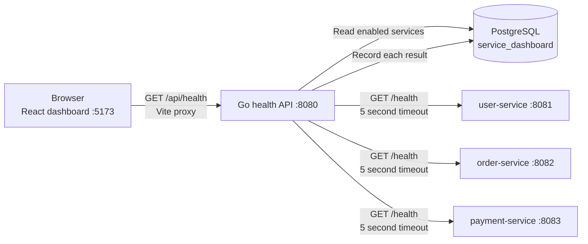
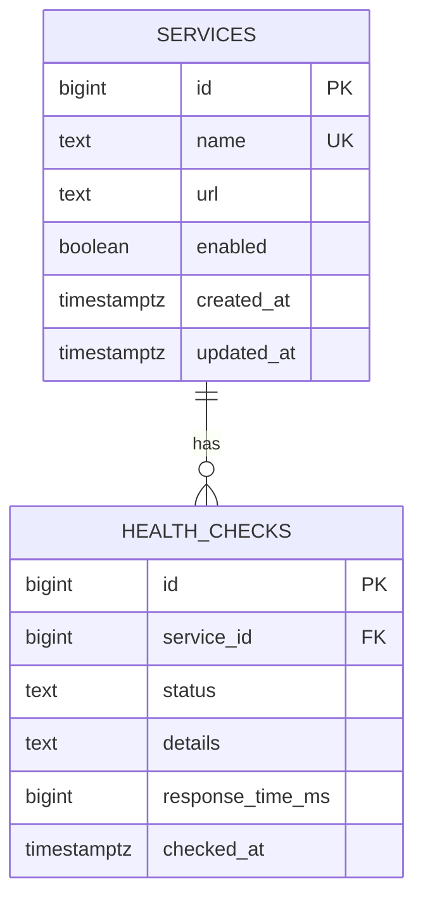

# Service Health Dashboard Architecture

## Overview

The application uses a React and TypeScript dashboard, a Go health API, three independently containerized sample services, and PostgreSQL. The dashboard asks the health API for a fresh check; the API loads enabled service definitions from the database, checks them concurrently, records each result, and returns the current statuses.

## Components and request flow



The browser calls the relative URL `/api/health`. During local development, Vite forwards `/api` requests to `http://localhost:8080`. Within Docker Compose, the health API reaches service containers using their Compose DNS names (`user-service`, `order-service`, and `payment-service`), and connects to PostgreSQL using the name `postgres`.

### Request lifecycle

1. The dashboard fetches `GET /api/health` at startup and when the user selects **Refresh**.
2. The health API queries PostgreSQL for enabled rows in `services`.
3. It sends a concurrent HTTP GET to each configured health-check URL. Each request has a five-second timeout.
4. A 2xx response is `UP`. A timeout, connection/request error, or non-2xx response is `DOWN`, with a detail such as `Timeout` or `HTTP 503`.
5. The API writes a row to `health_checks` for each result, then returns the current results to the dashboard.
6. The dashboard displays service name, status, and failure detail when present. It also provides summary counts, refresh, an error state for API failures, and an optional light/dark theme.

## Relational data model



`services` stores the configurable service name, health URL, and enabled flag. `health_checks.service_id` references `services.id`; deleting a service deletes its history through `ON DELETE CASCADE`. Status is constrained to `UP` or `DOWN`, and an index on `(service_id, checked_at DESC)` supports recent-history lookups. The dashboard intentionally omits response time; it is retained in PostgreSQL for recorded check history.

The Go API embeds `schema.sql` and initializes the tables and sample service rows at startup. The seed URLs use Compose service names and target `/health` on each service container.

## HTTP interface

### `GET /api/health`

Returns a timestamp and one result per enabled service. Example:

```json
{
  "checkedAt": "2026-10-21T10:30:00Z",
  "services": [
    { "name": "user-service", "status": "UP" },
    { "name": "order-service", "status": "DOWN", "details": "Timeout" },
    { "name": "payment-service", "status": "UP" }
  ]
}
```

If service configuration cannot be read, the endpoint returns HTTP 500. The frontend presents API/network failures in a backend-unavailable panel with a retry action.

## Local development and container ports

| Component | Local address / published port | Purpose |
| --- | --- | --- |
| Vite dashboard | `http://localhost:5173` | Browser UI; proxies `/api` to the health API |
| Health API | `http://localhost:8080` | `GET /api/health` |
| user-service | `http://localhost:8081` | `GET /health` |
| order-service | `http://localhost:8082` | `GET /health` |
| payment-service | `http://localhost:8083` | `GET /health` |
| PostgreSQL | `localhost:5433` → container `5432` | Relational data store; host port avoids local port conflicts |

Start the backend stack from `app-code/backend` with `docker compose up --build -d`. Start the frontend from `frontend` with `npm run dev`, then open `http://localhost:5173`. Compose stores PostgreSQL data in the `service-health-postgres-data` named volume so it persists across container restarts.
